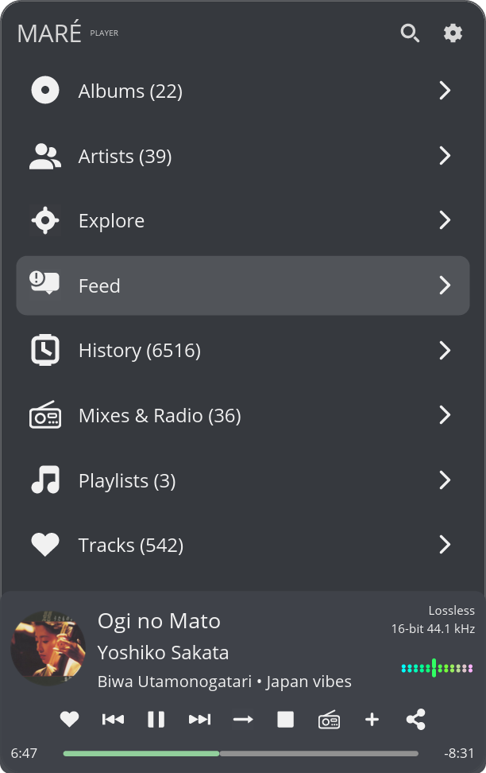
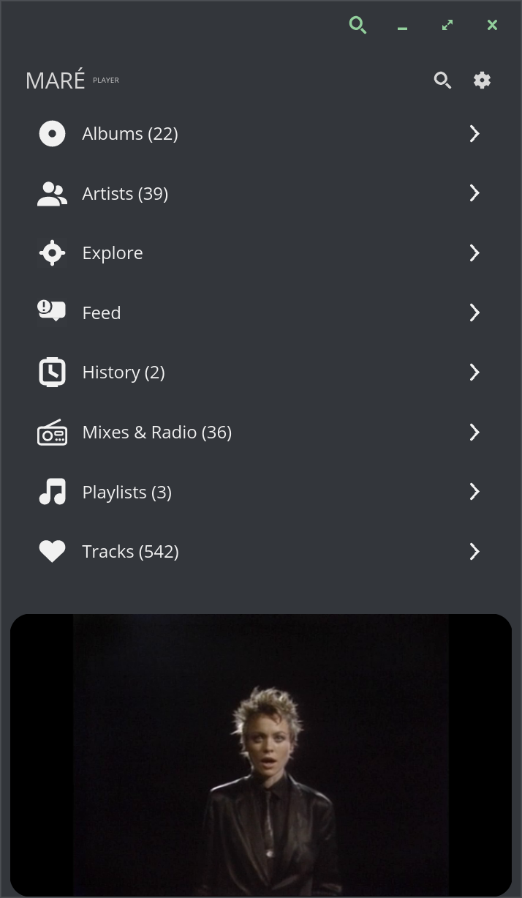

#  Maré Player

[](https://scorecard.dev/viewer/?uri=github.com/glima/mare-player)
[](https://www.bestpractices.dev/projects/15509)
[](https://codecov.io/gh/glima/mare-player)
[](https://github.com/glima/mare-player/releases/latest)


A COSMIC™ desktop application for the TIDAL music streaming service.
Stream Hi-Res audio, watch music videos, browse your library, and
control playback — with a real-time spectrum visualizer and full
MPRIS integration.

Builds as either a **panel applet** (popup from the system panel) or a
**standalone window** (regular application) — chosen at compile time
via the `panel-applet` feature flag (enabled by default).

<table align="center">
<tr>
<td align="center"></td>
<td align="center"></td>
</tr>
<tr>
<td align="center"><sub>Panel Applet mode</sub></td>
<td align="center"><sub>Standalone Window mode (playing video)</sub></td>
</tr>
</table>

## Features

- **Hi-Res Audio Playback** — Stream FLAC up to 24-bit/192 kHz (DASH),
  played through GStreamer (PipeWire/PulseAudio output)
- **Music Video Playback** — Stream TIDAL music videos (HLS, H.264/AAC)
  through a GStreamer pipeline, shown in an auto-hiding "theater" HUD
  with the same clickable title/artist/context and transport controls
  as the audio bar
- **Gapless Playback** — The next track is preloaded and decoded ahead
  of time for seamless, gap-free transitions
- **Volume Normalization** — Per-track replay-gain is applied so tracks
  play back at a consistent loudness
- **Real-time Spectrum Visualizer** — FFT-based stereo frequency
  display in the now-playing bar, driven by a PCM tap on the GStreamer
  playback pipeline (audio tracks and music videos alike)
- **MPRIS D-Bus Integration** — Control playback from any MPRIS client
  (playerctl, KDE Connect, desktop media keys, etc.)
- **Library Browsing** — Playlists, albums, followed artists, mixes &
  radio, and favorite tracks, each sortable A–Z or by date
- **Playlists** — Add the playing track, or the one you're looking at,
  to one of your playlists or to a new private or public one; delete
  the playlists you created
- **Explore** — Browse TIDAL's curated pages: a Featured carousel plus
  Genres, Moods & Activities, Decades, and more, with recursive
  drill-down navigation
- **Activity Feed** — New releases from the artists you follow, grouped
  by time period
- **Search** — Search tracks, albums, artists, and playlists across
  TIDAL's catalog
- **Track Radio** — Start a radio station from any track
- **Track Recommendations** — A per-track detail page with the artist's
  discography, related albums, and related artists
- **Lyrics** — Time-synced lyrics that highlight the current line (with
  a plain-text fallback when only flat lyrics are available)
- **Play History** — A locally-tracked, searchable list of recently
  played tracks
- **Artist Detail** — Bio, top tracks, and discography for any artist
- **Favorites** — Add/remove tracks, albums, and follow/unfollow
  artists
- **Shuffle** — Shuffle play for playlists, albums, mixes, and
  favorites
- **Sharing** — Generate song.link URLs and copy to clipboard
- **Dual Mode** — Builds as a COSMIC panel applet *or* a standalone
  windowed application (`--no-default-features`)
- **Secure Authentication** — Browser sign-in, with credentials stored in
  the system keyring
- **Persistent Sessions** — Automatic token refresh across reboots
- **Disk Caching** — Artwork is cached on disk with a configurable size
  limit and LRU eviction; library data (playlists, albums, history,
  lyrics) is cached in an embedded database for instant startup
- **Audio Quality Selection** — Low, High, Lossless, or Hi-Res
  (Master)

## Installation

Maré comes in two variants. Install only one: they ship the same files, so
their packages can't be installed side by side.

- **Panel applet** (`cosmic-applet-mare`): lives in the COSMIC panel.
- **Standalone app** (`mare-player`): an ordinary application window.

| Your system | Install from | Updates |
|---|---|---|
| Fedora 44 or 45 | [COPR](#fedora-copr) | With your system updates |
| Debian 13, Ubuntu 24.04, Pop!_OS 24.04 or newer | [`.deb` package](#debian-and-ubuntu-deb) | Install each new release |
| Other Fedora-like RPM systems | [`.rpm` package](#other-rpm-distributions-rpm) | Install each new release |
| Any other distribution | [Tarball](#any-distribution-targz) | Install each new release |
| Anything, or to work on Maré | [Source](#from-source) | Pull and rebuild |

The packages and tarballs are attached to every
[release](https://github.com/glima/mare-player/releases/latest), for x86_64
and aarch64 (`amd64` and `arm64` in `.deb` names). They are built on Ubuntu
24.04, so they need glibc 2.39 or newer. Each release also ships `SHA256SUMS`
and signed provenance; see [Verifying a download](SECURITY.md#verifying-a-download).

### Fedora (COPR)

The [COPR repository](https://copr.fedorainfracloud.org/coprs/limachaves/mare-player/)
offers Fedora 44 and 45 packages for x86_64 and aarch64. Fedora-derived
systems need the same Fedora package base and architecture; these
instructions are for DNF-managed systems, not immutable editions.

If `dnf copr` is unavailable, install `dnf5-plugins` first (`dnf-plugins-core`
for DNF4). Then enable the repository and install the **standalone app**:

```sh
sudo dnf copr enable limachaves/mare-player
sudo dnf install mare-player
```

For the **COSMIC panel applet**, install `cosmic-applet-mare` instead:

```sh
sudo dnf install cosmic-applet-mare
```

Updates arrive with normal system updates (`sudo dnf upgrade`). AAC and H.264
additionally need RPM Fusion's `gstreamer1-libav`; see
[Playback codecs](#playback-codecs-runtime). For source packaging and release
automation, see the [maintainer guide](packaging/rpm/README.md).

### Debian and Ubuntu (.deb)

Download the package for your variant and architecture from the
[latest release](https://github.com/glima/mare-player/releases/latest), then
install it with apt, which also pulls in its dependencies, GStreamer codecs
included:

```sh
sudo apt install ./mare-player_*_amd64.deb          # standalone app
sudo apt install ./cosmic-applet-mare_*_amd64.deb   # or the panel applet
```

With the [GitHub CLI](https://cli.github.com/), `gh release download --repo
glima/mare-player --pattern 'mare-player_*_amd64.deb'` fetches the package.

### Other RPM distributions (.rpm)

The `.rpm` packages name their dependencies the way Fedora does, so they suit
Fedora-like systems that COPR doesn't cover; on other RPM distributions, such
as openSUSE, use the [tarball](#any-distribution-targz). Download the package
from the [latest release](https://github.com/glima/mare-player/releases/latest)
and install it with dnf:

```sh
sudo dnf install ./mare-player-*.x86_64.rpm          # standalone app
sudo dnf install ./cosmic-applet-mare-*.x86_64.rpm   # or the panel applet
```

They pull in GStreamer's base and good plugins; add the bad and libav sets
from [Playback codecs](#playback-codecs-runtime).

### Any distribution (.tar.gz)

The tarball holds the binaries, the desktop entry, the AppStream metadata and
the icon. Its name doesn't change between releases, so the latest one is
always at the same URL. To install the **standalone app** under `/usr/local`:

```sh
curl -LO https://github.com/glima/mare-player/releases/latest/download/mare-player-x86_64.tar.gz
tar -xzf mare-player-x86_64.tar.gz
cd mare-player
sudo install -Dm755 -t /usr/local/bin mare-player
sudo install -Dm644 -t /usr/local/share/applications io.github.cosmic-applet-mare.desktop
sudo install -Dm644 -t /usr/local/share/metainfo io.github.cosmic-applet-mare.metainfo.xml
sudo install -Dm644 -t /usr/local/share/icons/hicolor/scalable/apps io.github.cosmic-applet-mare.svg
```

For the **panel applet**, download `cosmic-applet-mare-x86_64.tar.gz` instead
and install both of its binaries, `cosmic-applet-mare` and
`mare-video-window`. On ARM, use `aarch64` in the file name. To uninstall,
remove the installed files.

The tarball doesn't bring its dependencies: you need D-Bus, libsecret,
libxkbcommon and GStreamer with the [playback codecs](#playback-codecs-runtime),
and `wl-clipboard` for Copy Link on Wayland. Desktop systems usually have the
libraries already; the codecs and `wl-clipboard` may need installing.

### Playback codecs (runtime)

All playback — audio tracks **and** music videos — runs through GStreamer, so
the demuxers/decoders from the good/bad/libav plugin sets are required at
runtime: FLAC/AAC/MP3 for audio (DASH/HLS), and H.264 for video. The `.deb`
packages depend on all of them; the others don't, or not entirely.

```sh
# Fedora / RHEL (avdec_* come from RPM Fusion's gstreamer1-libav)
sudo dnf install gstreamer1-plugins-good gstreamer1-plugins-bad-free gstreamer1-libav

# Ubuntu / Debian
sudo apt install gstreamer1.0-plugins-good gstreamer1.0-plugins-bad gstreamer1.0-libav

# Arch
sudo pacman -S gst-plugins-good gst-plugins-bad gst-libav
```

### From source

#### Dependencies

Install the required system libraries before building:

```sh
# Fedora / RHEL
sudo dnf install dbus-devel libsecret-devel libxkbcommon-devel \
    gstreamer1-devel gstreamer1-plugins-base-devel

# Ubuntu / Debian
sudo apt install libdbus-1-dev libsecret-1-dev libxkbcommon-dev \
    libgstreamer1.0-dev libgstreamer-plugins-base1.0-dev

# Arch
sudo pacman -S dbus libsecret libxkbcommon gstreamer gst-plugins-base
```

Playback also needs the [playback codecs](#playback-codecs-runtime).

#### Build & Install

Requires Rust 2024 edition (1.85+) and [just](https://github.com/casey/just).

```sh
git clone https://github.com/glima/mare-player.git
cd mare-player

# Panel applet (default — installs into the COSMIC panel)
just build-release
just install

# Standalone window application
just build-release-standalone
just install-standalone
```

## Usage

### First-time Setup

1. Click the Maré Player icon in your panel (or launch the standalone app)
2. Click **Sign in with TIDAL**, then **Open Browser**
3. Sign in on TIDAL's page, with Google, Apple or your email. The browser
   hands the result back to Maré and the sign-in completes on its own

If the login screen asks you to paste a URL, another application owns the
`tidal://` scheme. Take it back, as your user rather than root:

```sh
xdg-mime default io.github.cosmic-applet-mare.desktop x-scheme-handler/tidal
```

### Browsing & Playback

- **Collection** — View your playlists, albums, artists, and favorite
  tracks from the main screen
- **Search** — Tap the search icon to find tracks, albums, artists, and
  playlists
- **Explore** — Browse TIDAL's curated pages (genres, moods, decades,
  featured) with drill-down navigation
- **Mixes & Radio** — Browse your personalized TIDAL mixes
- **Feed** — See new releases from the artists you follow
- **History** — Revisit recently played tracks (searchable)
- **Track Radio** — Start a radio station from any track via the radio
  button
- **Music Videos** — Video tracks (marked with a video badge) play in a
  full-area theater whose controls and track info auto-hide; move the
  pointer to bring them back
- **Lyrics** — Open the lyrics view for the current track; synced
  lyrics highlight the active line
- **Artist Detail** — Tap an artist name to see bio, top tracks, and
  discography
- **Track Detail** — Tap a track title to see related albums and
  artists seeded from it
- **Now Playing** — Playback controls, seek bar, shuffle, and spectrum
  visualizer
- **MPRIS** — Use media keys or any MPRIS controller (e.g.
  `playerctl play-pause`)
- **Sharing** — Share the currently playing track via song.link
- **Settings** — Audio quality and account info via
  the gear icon

## Configuration

Configuration is managed through COSMIC's config system. Available
settings:

| Setting | Description | Default |
|---|---|---|
| Audio Quality | Low / High / Lossless / Hi-Res | Hi-Res |
| Image Cache Limit | Max disk space for cached artwork | 200 MB |

The playback volume is also persisted across restarts.

## Building

A [justfile](./justfile) provides all common workflows:

| Recipe | Description |
|---|---|
| `just` | Build applet with release profile (default) |
| `just build-release` | Build applet with release profile |
| `just build-debug` | Build applet with debug profile |
| `just build-release-standalone` | Build standalone window app (release) |
| `just build-debug-standalone` | Build standalone window app (debug) |
| `just build-vendored` | Build applet with vendored dependencies |
| `just build-vendored-standalone` | Build standalone with vendored dependencies |
| `just run` | Build and run applet (`RUST_BACKTRACE=full`) |
| `just run-debug` | Build and run applet (debug profile) |
| `just run-standalone` | Build and run standalone (release) |
| `just run-standalone-debug` | Build and run standalone (debug) |
| `just check` | Clippy lint check |
| `just test` | Run tests with cargo-nextest (falls back to cargo test) |
| `just test-verbose` | Tests with immediate stdout/stderr output |
| `just coverage` | HTML + LCOV coverage report via cargo-llvm-cov |
| `just coverage-summary` | Text-only coverage summary |
| `just doc` | Build docs (including private items) |
| `just doc-open` | Build docs and open in browser |
| `just bloat-check` | Analyze binary size by crate/function |
| `just stats` | Code statistics via tokei |
| `just install` | Install applet system-wide |
| `just install-debug` | Install applet (debug build) |
| `just install-standalone` | Install standalone app system-wide |
| `just install-standalone-debug` | Install standalone app (debug build) |
| `just uninstall` | Remove installed files |
| `just clean` | `cargo clean` |
| `just clean-dist` | Clean build artifacts and vendored deps |
| `just vendor` | Vendor dependencies for offline builds |
| `just tag <version>` | Bump version, commit, and create git tag |

### Viewing logs

The panel applet logs to **stderr**, which `cosmic-panel` forwards to the
systemd journal tagged `io.github.cosmic-applet-mare:`. Follow them live with:

```sh
journalctl --user _COMM=cosmic-panel -f | grep --line-buffered cosmic-applet-mare
```

Adjust verbosity at runtime from **Settings → Logging** (Error … Trace); the
change applies immediately, no restart.

## Project Structure

```
src/
├── playback/       # GStreamer engine (MediaPlayer): audio + video playbin, replay-gain volume, tee'd PCM tap, RGBA video appsink, gapless
├── audio/          # FFT spectrum analyzer (fed by the playback PCM tap)
├── tidal/          # TIDAL API client, PKCE auth, player queue, MPRIS2 D-Bus interface
├── handlers/       # Message handlers: auth, data loading, navigation, playback, misc (images, sharing, MPRIS, screenshots)
├── views/          # UI views
│   ├── components/ # Reusable components: FadingClip widget, icons, constants, list helpers, row builders
│   ├── visualizer  # Audio spectrum visualizer widget
│   └── *.rs        # Panel, popup, albums, artists, playlists, tracks, track detail, mixes, search, explore, feed, history, lyrics, profiles, settings, auth, share, …
└── *.rs            # App model, state, messages, config, disk caching, image cache, helpers, menu
```

## Key Dependencies

| Crate | Purpose |
|---|---|
| [libcosmic](https://github.com/pop-os/libcosmic) | COSMIC application framework |
| [tidlers](https://codeberg.org/tomkoid/tidlers) | TIDAL API client |
| [gstreamer-rs](https://gitlab.freedesktop.org/gstreamer/gstreamer-rs) | Playback engine for all audio and video (decode, stream, output, volume, seek, gapless) |
| [rustfft](https://crates.io/crates/rustfft) | FFT for spectrum analysis |
| [zbus](https://crates.io/crates/zbus) | D-Bus / MPRIS2 interface |
| [keyring](https://crates.io/crates/keyring) | System credential storage |
| [reqwest](https://crates.io/crates/reqwest) | HTTP client for API requests |
| [image](https://crates.io/crates/image) | Decoding/processing album & video artwork |

## Acknowledgments

- Built with [libcosmic](https://github.com/pop-os/libcosmic)
- TIDAL API access via [tidlers](https://codeberg.org/tomkoid/tidlers)

## Contributing

Bug reports, translations and patches are welcome — see
[CONTRIBUTING.md](./CONTRIBUTING.md) for the setup, the checks CI gates on,
and the commit-message and dependency-licence rules.

## License

[GPL-3.0-only](LICENSE)

## Disclaimer

TIDAL is a registered trademark of TIDAL Music AS. This is an
unofficial application and is not affiliated with or endorsed by TIDAL.
Use at your own risk and ensure compliance with TIDAL's Terms of
Service.
